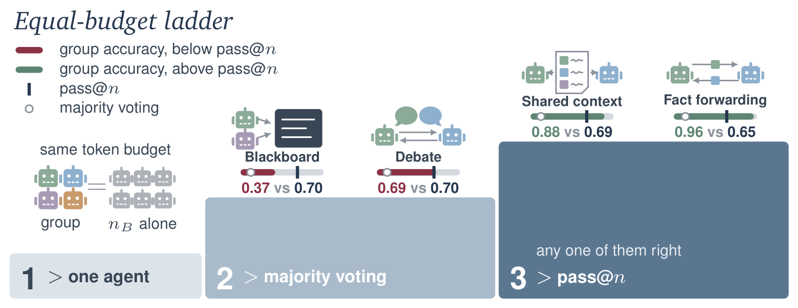
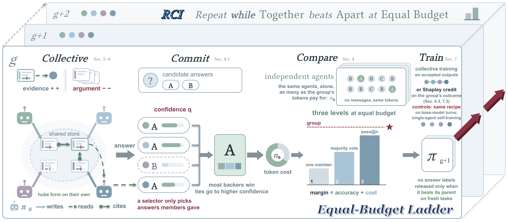

<div align="center">

# Recursive Collective Intelligence

### Emergence on an Equal-Budget Ladder in Multi-Agent LLM Systems

**Lixuan He**<sup>1</sup> · **Shengqu Cai**<sup>1</sup> · **Fang Wu**<sup>1</sup> · **Shikang Zheng**<sup>2</sup> · **Liwei Jiang**<sup>3</sup> · **Manling Li**<sup>4</sup><br>
**Yi Ma**<sup>2</sup> · **Li Fei-Fei**<sup>1</sup> · **Leonidas Guibas**<sup>1</sup> · **Gordon Wetzstein**<sup>1</sup> · **Yejin Choi**<sup>1</sup> · **Yining Hong**<sup>1</sup>

<sup>1</sup>Stanford University &nbsp;&nbsp; <sup>2</sup>University of California, Berkeley &nbsp;&nbsp; <sup>3</sup>NVIDIA &nbsp;&nbsp; <sup>4</sup>Northwestern University

[](https://lixuan27.github.io/RCI/)
[](https://lixuan27.github.io/RCI/blog/)
[](https://lixuan27.github.io/RCI/playground/)
[](https://lixuan27.github.io/RCI/)


</div>

<p align="center">
  
</p>
<p align="center"><sub><b>The equal-budget ladder.</b> A group whose tokens would pay for n<sub>B</sub> independent agents reaches level 1 when it beats one agent, level 2 when it beats their majority vote and level 3 when it exceeds their pass@n<sub>B</sub>.</sub></p>

## Overview

Language models increasingly work as teams of agents, and a team is usually credited for beating one agent while it spends many times that agent's tokens. This repository grades every group against **independent agents that spend the same tokens** and asks two questions: when does interaction itself make a group smarter than its members working apart, and can a group make its next generation smarter using only its own output?

- **An equal-budget ladder.** Every group is compared with independent copies of its own model at the group's token budget. The top level exceeds pass@n, which no selection among independent answers can reach, so it isolates what interaction adds.
- **Interaction that moves information.** Protocols that pass decisive facts between agents rise above pass@n, while protocols that exchange conclusions stay at the vote.
- **Emergent organization.** Identical agents with a scarce reading budget build hubs and relays on their own, and the token accounting shows what this coordination costs.
- **Recursive collective intelligence.** Label-free generations train on turns that the group's own protocol verifies, and gated recursion releases a new generation only when it beats its predecessor on fresh tasks.

The release reproduces the **procedures** of the paper. Runs are sampled at temperature 1 on served models, so a rerun gives new records; the drivers print every run, training and grading command so that each number in the paper can be regenerated with the same settings. This README therefore quotes no results; the [project page](https://lixuan27.github.io/RCI/) and the [blog](https://lixuan27.github.io/RCI/blog/) present them.

<p align="center">
  
</p>
<p align="center"><sub><b>One generation.</b> Copies of one policy interact and commit to an answer, the answer is graded against independent agents at equal cost, and the next generation trains on the outputs that the group's protocol accepts.</sub></p>

## Contents

- [Repository layout](#repository-layout)
- [Installation](#installation)
- [Models and serving](#models-and-serving)
- [Data](#data)
- [Reproducing the paper](#reproducing-the-paper)
- [Gated recursion on PlanBench, HiddenBench and Hanabi](#gated-recursion-on-planbench-hiddenbench-and-hanabi)
- [Compute](#compute-estimates-from-the-papers-appendix)
- [Names in the code and in the paper](#names-in-the-code-and-in-the-paper)
- [License](#license) · [Citation](#citation) · [Contact](#contact)

## Repository layout

| path | content |
|---|---|
| `rci/` | the package: agents and harness, blackboard, protocols, tasks, ladder, organization, recursion, training, gated recursion |
| `experiments/` | one YAML (exact settings) and one driver per paper element |
| `configs/` | prompts and role cards the model wrote for itself, task lists, credit-training configuration |
| `scripts/data/` | download and preparation of every benchmark (nothing is redistributed) |
| `scripts/launch/` | serving, running, SFT, credit-training and recursion launchers, one optional SLURM template |
| `tests/` | offline CPU tests (no GPU, no network) |

## Installation

Python 3.11 or newer (the experiments used Python 3.12, vLLM and PyTorch on H200 and A800 GPUs).

```bash
pip install -e ".[serve,train,bench,test]"   # or: pip install -r requirements.txt && pip install -e .
cp configs/env.example .env && set -a && . ./.env && set +a
pytest -q tests
```

Run every command from the repository root, inside an environment that provides `python` (the launchers honour
`PYTHON=python3`); the launchers need bash 4.4 or newer. The drivers in `experiments/` and the tests also run
without the editable install.

A GPU-free check of the pipeline, besides the tests:

```bash
python experiments/ladder.py lines --model q27          # the run lines of Table 2
python experiments/recursion.py plan --chain step3_9    # harvest, rows, SFT and evaluation commands of a run
python experiments/credit.py example                    # the three credit rules on a worked example
python experiments/threshold.py --check                 # Proposition 2, checked numerically
```

Every path is configurable through environment variables (`rci/paths.py`); defaults are relative to the repository.

<details>
<summary>Environment variables</summary>

| variable | default | content |
|---|---|---|
| `RCI_DATA` | `./data` | benchmark and generated task data |
| `RCI_RESULTS` | `./results` | run records, grading specs and outputs |
| `RCI_CKPT` | `./checkpoints` | trained generations (`<served name>/hf`) and credit-training runs |
| `RCI_MODELS` | `./models` | base model weights, one directory per model |
| `RCI_CACHE` | `$TMPDIR/rci` | compile caches, sandbox layers, staging |
| `RCI_LOGS` | `./logs` | launcher logs |
| `RCI_BASE_URLS` | unset | comma list of OpenAI-compatible endpoints used by printed run lines |
| `RCI_JOB_ID` | process id | owner tag of result lock files |
| `RCI_GPTOSS_SYSTEM_DATE` | unset | optional fixed date for the gpt-oss system prompt |
| `RCI_SWE_PYTHON` | current interpreter | Python with the SWE-bench harness, used to grade patches |

</details>

## Models and serving

Served names: `qwen3.5-4b`, `qwen3.5-9b`, `qwen3.8-27b`, `qwen3.6-35b-a3b`, `gpt-oss-120b`, `glm-4.5-air-fp8`.
A trained generation is served as `<base>-g<k>[tag]-l<lineage>` (control: `<base>-ctrl[tag]-l<lineage>`, replication
seeds add `-t<seed>`), and its weights are found at `$RCI_CKPT/<served name>/hf`.

```bash
python scripts/data/download_models.py qwen3.8-27b qwen3.5-9b qwen3.5-4b qwen3.6-35b-a3b
scripts/launch/serve.sh start qwen3.8-27b --gpus 0,1,2,3        # one vLLM server per TP group; prints RCI_BASE_URLS
python experiments/ladder.py lines --model q27 > lines.txt
scripts/launch/run_lines.sh lines.txt --model qwen3.8-27b --jobs 4
scripts/launch/serve.sh stop qwen3.8-27b
```

Family-specific serving flags (parsers, tensor parallelism, context length, sampling) come from
`python -m rci.agents.families shell <served name>`. `scripts/launch/slurm_template.sbatch` wraps the same scripts
for a SLURM cluster (`MODE=eval|sft|credit`); create its log directory first (`mkdir -p logs/slurm`).

## Data

Prepare in this order; every download is pinned to a revision and checked against a content hash.

| step | command | output |
|---|---|---|
| models | `python scripts/data/download_models.py ...` | `$RCI_MODELS/<model>` |
| HiddenBench (65 tasks) | `python scripts/data/prepare_hiddenbench.py` | `data/hiddenbench/benchmark.json` |
| SplitBench and control set | `scripts/data/prepare_splitbench.sh` (writer: 27B served) | `data/splitbench{,_control}/{train,heldout}` |
| 56-task subset | shipped as `configs/hiddenbench/tasks56.json`; regenerate with `python -m rci.tasks.hiddenbench.subset` | |
| DocSweep | `scripts/data/prepare_docsweep.sh` (27B tokenizer and model) | `data/docsweep`, admitted question list |
| contradiction audit | `scripts/data/prepare_audit.sh` (writer: 27B served) | `data/audit/{eval,train}` |
| GPQA-Diamond | `python scripts/data/prepare_gpqa.py` | `data/gpqa` |
| LongBench v2 | `python scripts/data/prepare_longbench2.py` | `data/longbench2` |
| MMLongBench-Doc | `python scripts/data/prepare_mmlongdoc.py` | `data/mmlongdoc` |
| BrowseComp-Plus | `python scripts/data/prepare_browsecomp.py && python -m rci.tasks.browsecomp.bm25 build` | `data/browsecomp` |
| SWE-bench Verified | `python scripts/data/prepare_swe.py` | `data/swe` (images in a local store) |
| FATE-M | `scripts/data/install_lean.sh && scripts/data/prepare_fate.sh`, then `scripts/launch/serve_lean.sh` | `data/fate` |

SplitBench and DocSweep are generated by a model, so a regenerated set differs from the one used in the paper.
The train / held-out split is drawn by a hash rule with the paper's proportions (`rci/tasks/splitbench/split.py`), so
a regenerated set gives a new split of the same sizes, not the paper's item list; `prepare_splitbench.sh --ids-file`
applies a split you supply. The writer's answer key is sealed into `writer_key.json`, which no run reads.
`configs/docsweep/questions.json` lists the 128 admitted questions of the paper with reference hashes of their
corpora, so a regenerated corpus can be compared with ours. Never publish benchmark items: several benchmarks ask
that their examples stay offline.

## Reproducing the paper

Each driver prints the commands of its experiment (`lines`) and grades the records (`grade`); `--dry-run` prints
instead of running, and no driver starts a GPU job by itself. Model keys (`q27`, `q9`, ...) are defined in each YAML.

| paper element | settings | commands |
|---|---|---|
| Table 1 (GPQA-Diamond, DocSweep) | `experiments/shared.yaml` | `python experiments/shared.py lines`, `... grade` |
| Table 2, Figure 5b | `experiments/ladder.yaml` | `python experiments/ladder.py lines --model q27`, `... grade` |
| Table 3, Figures 6–8 | `experiments/emergence.yaml` | `python experiments/emergence.py lines`, `... grade`, `... structure`, `... prompts` |
| Figure 9, Table 9 | `experiments/channels.yaml` | `python experiments/channels.py channels`, `... ledger` (after ladder and emergence) |
| Table 4, Appendix F | `experiments/recursion.yaml` | `python experiments/recursion.py plan --chain step3_9` (harvest, rows, SFT, evaluation), `... contrasts` |
| Table 10 | `experiments/collective.yaml` | `python experiments/collective.py lines`, `... solo_team`, `... own_pool` |
| Table 5, Tables 13–14 | `experiments/credit.yaml`, `configs/credit/` | `python experiments/credit.py train`, `... eval`, `... heldout`, `... curves` |
| Figure 13 | | `python experiments/credit.py example` |
| Figure 5c, Table 12 | `experiments/prior.yaml` | `python experiments/prior.py lines`, `... judge`, `... reviews`, `... grade`, `... table` |
| Appendix F (supervisor) | `experiments/supervisor.yaml` | `python experiments/supervisor.py evolve`, `... lines`, `... contrasts` |
| Figure 14a, Proposition 2 | | `python experiments/threshold.py --check --plot threshold.pdf` |

Grading is CPU-only: `python -m rci.ladder.grade SPEC --out DIR` computes the unit cost, the budget `n_B`, the
references `V(n)` and `T(n)` (seat-stratified on hidden-profile tasks, exact per question on DocSweep), the margin
over pass@n and the level reached, with question-clustered paired tests and Benjamini-Hochberg flags. Costs are
graded in completion tokens or total tokens (`--cost`); the synthetic GPU unit that the appendix also reports for
DocSweep and the A/A checks of the appendix are not part of this release.

Notes on what the drivers reproduce:

- The recursion runs (`step3_9`, `step3_27`, `standard9`, `standard4`) harvest first turns on the SplitBench
  training tasks **and** the training half of the control set, as the experiments ran; generations are evaluated on
  the 196 held-out SplitBench tasks and on HiddenBench against a frozen pool of 32 base-model members per question.
- The 9B first generation is rebuilt here from the forwarding-debate harvest of the base model at seed 4 (every
  first turn that passes the check); the experiments used an earlier harvest of the same protocol and check. The
  control samples the base model in the same first-turn contexts as the second generation of its lineage.
- The 4B run (`standard4`) uses its own operator, as it ran: the strict criterion, first turns sampled in the
  forwarding contexts and written after both the forwarding and the free-debate prompt, commit rows as one quarter
  of the rows at weight one, 480 steps per generation, and separate harvest seeds for the commit rows of each
  row set.
- Table 5's "Shapley credit" row was trained with `credit: shapley` (Shapley shares). The full rule with citation
  flow is `credit: shapley_flow` (`gamma = 0.5`, `lambda = 0.25`); both are configured in `configs/credit/arms.yaml`,
  and the stages table compares them in the distributed setting.
- Self-written prompts in `configs/notes/` are the ones the model wrote for the paper; `experiments/emergence.py
  prompts` writes new ones into `$RCI_RESULTS` without touching the shipped files.
- The gpt-oss system prompt carries no fixed date unless `RCI_GPTOSS_SYSTEM_DATE` is set.

## Gated recursion on PlanBench, HiddenBench and Hanabi

`rci/chains/` runs the gated recursion of Section 4.4 and Appendix L. Every round the
current generation plays fresh training tasks with its collective protocol, an automatic check accepts or rejects
each output without answer labels (the plan simulator on PlanBench, agreement with the base model's full-information
answer on HiddenBench, the game score on Hanabi), candidates continue from the current generation's full-precision
weights on the accepted outputs (alpha != 1 candidates are weight interpolations, `rci/chains/merge.py`), the best
healthy candidate on the selection set meets the current generation on fresh confirmation tasks paired by task, and it
is released only when its paired gain passes the run's rule (`rci/chains/stats.py`); otherwise the round is flat.

| paper element | settings | runs |
|---|---|---|
| Table 6, Figure 10a, Table 15 (PlanBench) | `experiments/chains_planbench.yaml` | `planbench` |
| Figures 10b, 11a and 12, Table 15 (HiddenBench) | `experiments/chains_hiddenbench.yaml` | `t3`, `t3_solo` (single-agent self-training), `t3k` |
| Table 7, Figure 10c, Table 15 (Hanabi) | `experiments/chains_hanabi.yaml` | `hanabi`, `hanabi_control` (non-recursive) |

```bash
python experiments/chains_planbench.py prepare            # generated Blocksworld sets, no official problem (CPU)
python experiments/chains_hiddenbench.py prepare          # prints the writing, admission and freezing commands
python experiments/chains_planbench.py plan --chain planbench   # every step of a round with its command
scripts/launch/run_chain.sh experiments/chains_planbench.py planbench --gpus 0,1,2,3
scripts/launch/run_chain.sh experiments/chains_hanabi.py hanabi --gpus 0,1,2,3
scripts/launch/run_chain.sh experiments/chains_hanabi.py hanabi_control --gpus 4,5,6,7   # after G1 of hanabi
scripts/launch/run_chain.sh experiments/chains_hiddenbench.py t3 --gpus 0,1,2,3
python experiments/chains_hiddenbench.py status --chain t3
```

`run_chain.sh` asks the driver for the next step (`next --chain C --tsv`), runs a CPU step in the driver (`step`) or a
GPU line on the given GPUs and marks it (`done`), until the run stops; any scheduler can run the same loop, since
every step is resumable and the state lives in `$RCI_RESULTS/chains/<chain>/state.json` next to every file a decision
read (`select.json`, `verdict.json`). GPU lines serve weights with `scripts/launch/with_server.sh` and train with
`scripts/launch/train_sft.sh --master` (a bf16 export to serve and a float32 master to continue from). Tasks are
generated or deals are seeded here, so a rerun gives new sets, not the paper's. The replicate populations, the
HiddenBench tail check of candidates and the second (cards-played) release channel of Hanabi are not part of this
release.

## Compute (estimates from the paper's appendix)

| job | hardware | time |
|---|---|---|
| one 27B HiddenBench cell of 448 records | one group of four GPUs (H200 or A800) | about 9 to 26 h, depending on the protocol |
| 27B GPQA-Diamond batch (ten cells and pools) | eight H200 GPUs | about 7.5 h |
| SFT of a 27B generation | eight A800 GPUs | about 75 min |
| SFT of a 9B generation | four A800 GPUs | about 17 to 27 min |
| one 4B Shapley-credit training step (40 steps per arm) | four H200 GPUs (two train, two serve) | about 10 to 14 min |

## Names in the code and in the paper

<details>
<summary>Mapping from configuration keys to the names used in the paper</summary>

| code | paper |
|---|---|
| `blackboard` protocol | BB (blackboard) |
| `blackboard_private` | independent members in the same environment |
| `independent` | independent agents, Parallel ReAct |
| `debate` with `rounds`, `forward_facts`, `shared_context`, `self_refine`, `team_file` | Debate-2R/3R, Fact forwarding, Shared context (SC), Self-Refine-2R, supervisor-written team |
| task kwarg `hint` | +H |
| task kwarg `conclude: complete` | Gated BB (only a complete reader may conclude) |
| `read_budget: [1]`, `transfers`, `planning_steps`, `budget_cap`, `forward_own_only` | No transfer, Self-organized, + planning round, budget cap, no relay |
| `read_budget: [4, -1]`; `read_budget: [2, 1, -1]` with `planning_steps_by_seat` and role cards | designed hub; designed tree |
| `prompt_file` | self-written prompt (from the rules / evolved) |
| `docsweep_board` | DocSweep Self-organized / Notes / Aggregator |
| `sequential` | Sequential-4 |
| `credit: team / shapley / shapley_flow`, `trainees: one`, `adv_mode: raft`, `n_agents: 1` | team reward / Shapley shares / Shapley credit with citation flow, one trainee, imitate wins, own success |
| `audit` task | contradiction audit (shared corpus; `partition: snippet` is the distributed setting) |
| G0, G1, G2, control | generations of a run; lineages `l0`, `l1` are the two training seeds |

</details>

## License

MIT (see `LICENSE`). Third-party code adapted in `rci/protocols/delm.py`, `rci/protocols/aorchestra.py`, the PlanBench
prompt and extraction (`rci/chains/planbench/`) and the benchmark graders keeps its original licence; see
`THIRD_PARTY_NOTICES.md`. Benchmark data are downloaded from their original sources under their own terms.

## Citation

```bibtex
@article{he2026rci,
  title   = {Recursive Collective Intelligence: Emergence on an
             Equal-Budget Ladder in Multi-Agent LLM Systems},
  author  = {He, Lixuan and Cai, Shengqu and Wu, Fang and Zheng, Shikang and
             Jiang, Liwei and Li, Manling and Ma, Yi and Fei-Fei, Li and
             Guibas, Leonidas and Wetzstein, Gordon and Choi, Yejin and
             Hong, Yining},
  year    = {2026}
}
```

## Contact

Questions and issues are welcome through [GitHub issues](https://github.com/lixuan27/RCI-official/issues) or by email to lixuanhe@stanford.edu.
